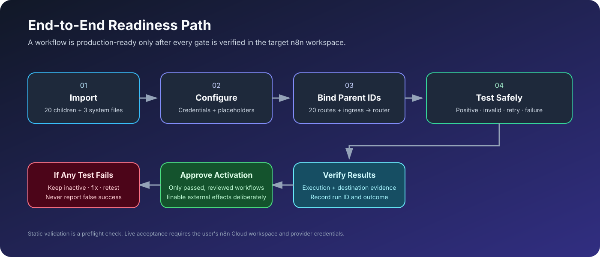

# FlowForge-AI

**A modular n8n A–Z automation system** maintained by **Muhammad Farhan**.

FlowForge-AI organizes 20 canonical business automation templates behind a shared parent/child orchestration layer. The repository includes n8n JSON exports, workflow-specific setup notes, a static validator, and end-to-end deployment guidance.

> **Honest status:** repository files can be statically inspected, but this project has not been live-executed in the user's n8n Cloud workspace from GitHub. Workflow IDs, credentials, provider permissions, configuration placeholders, and destination-side effects must be configured and verified in n8n. Do not describe a workflow as production-ready until its acceptance tests pass.

## Visual architecture


The system routes a validated request through `00 - Main Ingress` and `01 - Request Processor` to one of the 20 canonical child workflows. `90 - Central Error Handler` must be assigned in the n8n Error Workflow settings to receive automatic error events.

## Visual workflow gallery

- **[Open the interactive gallery](https://farhanillahiclass.github.io/FlowForge-AI/)** — searchable cards, category filters, and direct links to each workflow JSON and setup guide (available once GitHub Pages deployment succeeds).
- [Read the gallery guide](docs/WORKFLOW-GALLERY.md) for the catalog, architecture entry points, and safe setup guidance.
- Gallery source: [`site/`](site/). Deployment workflow: [`.github/workflows/deploy-gallery.yml`](.github/workflows/deploy-gallery.yml).

## End-to-end readiness process



## A–Z architecture

```text
External caller
  |
  | HTTPS + Header Auth + requestId/eventType/data
  v
system/00-main-ingress.json
  | validate envelope
  v
system/01-request-processor.json
  | map eventType -> one canonical child
  +-- lead.created ------------------------> 01 Lead Capture & CRM
  +-- lead.score_requested ---------------> 02 Lead Scoring & Routing
  +-- email.followup.dispatch -------------> 03 Email Follow-up Sequence
  +-- inbox.message.received -------------> 04 Inbox Triage Assistant
  +-- support.ticket.created -------------> 05 Customer Support Desk
  +-- support.faq.question ---------------> 06 FAQ & Human Handoff
  +-- meeting.booking.requested ----------> 07 Meeting Booking System
  +-- meeting.reminder.dispatch ----------> 08 Meeting Reminders
  +-- client.onboarding.start ------------> 09 Client Onboarding
  +-- invoice.reminder.dispatch ----------> 10 Invoice & Payment Reminders
  +-- content.draft.requested ------------> 11 Content Creation & Approval
  +-- instagram.publish.requested --------> 12 Instagram Publishing
  +-- youtube.upload.requested -----------> 13 YouTube Publishing Assistant
  +-- content.repurpose.requested --------> 14 Content Repurposing
  +-- newsletter.campaign.requested ------> 15 Newsletter Campaign Builder
  +-- business.report.generate -----------> 16 Weekly Business Report
  +-- feedback.received ------------------> 17 Feedback Routing
  +-- workflow.error.received ------------> 18 Workflow Error Monitor
  +-- api.health.check -------------------> 19 API Health Monitor
  +-- telegram.command.received ----------> 20 Telegram Business Assistant

Configured n8n Error Workflow ----------------> 90 Central Error Handler
```

The workflow IDs in exported JSON are workspace-specific placeholders. Select the real imported child workflows in the Execute Sub-workflow nodes in your n8n Cloud workspace.

## Workflow catalog

| # | Workflow | Area | Folder |
|---:|---|---|---|
| 01 | Lead Capture & CRM | Sales | [Open](workflows/01-lead-capture-crm/README.md) |
| 02 | Lead Scoring & Routing | Sales | [Open](workflows/02-lead-scoring-routing/README.md) |
| 03 | Email Follow-up Sequence | Sales | [Open](workflows/03-email-follow-up-sequence/README.md) |
| 04 | Inbox Triage Assistant | Productivity | [Open](workflows/04-inbox-triage-assistant/README.md) |
| 05 | Customer Support Desk | Customer support | [Open](workflows/05-customer-support-desk/README.md) |
| 06 | FAQ & Human Handoff | Customer support | [Open](workflows/06-faq-human-handoff/README.md) |
| 07 | Meeting Booking System | Scheduling | [Open](workflows/07-meeting-booking-system/README.md) |
| 08 | Meeting Reminders | Scheduling | [Open](workflows/08-meeting-reminders/README.md) |
| 09 | Client Onboarding | Operations | [Open](workflows/09-client-onboarding/README.md) |
| 10 | Invoice & Payment Reminders | Finance operations | [Open](workflows/10-invoice-payment-reminders/README.md) |
| 11 | Content Creation & Approval | Content operations | [Open](workflows/11-content-creation-approval/README.md) |
| 12 | Instagram Publishing Pipeline | Content operations | [Open](workflows/12-instagram-publishing-pipeline/README.md) |
| 13 | YouTube Publishing Assistant | Content operations | [Open](workflows/13-youtube-publishing-assistant/README.md) |
| 14 | Content Repurposing | Content operations | [Open](workflows/14-content-repurposing/README.md) |
| 15 | Newsletter Campaign Builder | Marketing | [Open](workflows/15-newsletter-campaign-builder/README.md) |
| 16 | Weekly Business Reporting | Analytics | [Open](workflows/16-weekly-business-report/README.md) |
| 17 | Feedback & Escalation | Customer experience | [Open](workflows/17-feedback-routing/README.md) |
| 18 | Workflow Error Monitor | Reliability | [Open](workflows/18-workflow-error-monitor/README.md) |
| 19 | API Health Monitor | Reliability | [Open](workflows/19-api-health-monitor/README.md) |
| 20 | Telegram Business Assistant | Messaging | [Open](workflows/20-telegram-business-assistant/README.md) |

Browse the [complete workflow index](workflows/README.md), [credentials guide](workflows/CREDENTIALS-GUIDE.md), and [parent-child orchestration guide](system/PARENT-CHILD-ORCHESTRATION.md).

## Repository layout

```text
FlowForge-AI/
├── .github/workflows/          # Static checks on pushes and PRs
├── docs/                       # Architecture, contribution guide, SVG diagrams
├── scripts/                    # Repository validator
├── system/
│   ├── 00-main-ingress.json
│   ├── 01-request-processor.json
│   ├── 90-central-error-handler.json
│   ├── README.md
│   ├── N8N-CLOUD-2X-DEPLOYMENT.md
│   └── PARENT-CHILD-ORCHESTRATION.md
├── workflows/
│   ├── README.md
│   ├── CREDENTIALS-GUIDE.md
│   └── <workflow-slug>/
│       ├── README.md
│       ├── workflow.json
│       └── Code.gs             # optional Apps Script adapter
├── TESTING-AND-VALIDATION.md
├── LICENSE
└── README.md
```

Each business workflow has one canonical export at `workflows/<slug>/workflow.json`. Avoid reintroducing duplicate root-level JSON copies or parallel guide folders.

## Quick start — n8n Cloud 2.x

1. Read [n8n Cloud 2.x deployment guide](system/N8N-CLOUD-2X-DEPLOYMENT.md), [system instructions](system/README.md), and [credentials guide](workflows/CREDENTIALS-GUIDE.md).
2. Import the 20 canonical child JSON files into a **test project**. Keep them inactive.
3. Configure credentials and replace provider-specific placeholders inside n8n.
4. Import `system/01-request-processor.json`; select the correct child workflow in each of its 20 Execute Sub-workflow nodes.
5. Import `system/00-main-ingress.json`; select the Request Processor workflow and configure Header Auth.
6. Import `system/90-central-error-handler.json`; configure its log and alert destination, then assign it in **Workflow Settings → Error Workflow** for workflows that should report errors.
7. Test each child directly if direct access is intended, and test every route through Main Ingress using synthetic data.
8. Inspect n8n execution history and verify the actual destination (sheet, inbox, calendar, API, or test account). Record the execution ID and result.
9. Keep customer-facing messages, invoice reminders, newsletters, and public publishing disabled until the applicable acceptance tests pass.

Example parent envelope:

```json
{
  "requestId": "test-lead-0001",
  "eventType": "lead.created",
  "source": "flowforge-test",
  "occurredAt": "2026-10-19T09:00:00.000Z",
  "data": {
    "name": "Test Person",
    "email": "test@example.com",
    "company": "Example Test Co",
    "message": "Synthetic test lead"
  }
}
```

Use a stable `requestId` when deliberately retrying the same event. Test with synthetic records and test recipients only.

## Validate locally

Requires Python 3.10 or later.

```bash
python scripts/validate_workflows.py
```

The validator checks canonical folder structure, JSON syntax and graph references, node identity uniqueness, webhook authentication, expected system files, and parent route consistency. GitHub Actions runs static validation on pushes and pull requests.

**Static validation is not an n8n runtime test.** It cannot verify n8n 2.x node schema compatibility, OAuth credentials, API permissions, schedule behavior, provider-side effects, or exact-once processing.

## Completion status and known gaps

A workflow is complete for deployment only after the target workspace has valid credentials/configuration, correct parent-child binding, and passing positive, invalid-input, retry/duplicate, provider-failure, and destination-verification tests.

Known areas requiring extra attention:
- Google Sheets read-before-write is not strict exactly-once protection under concurrent requests.
- Meeting booking needs availability/conflict checks before being treated as production-safe.
- Reminder and invoice workflows need retry reconciliation when an external send succeeds but logging fails.
- Content review messages do not automatically constitute a persistent approval callback.
- Instagram and YouTube uploads require destination-side processing/status verification.
- Newsletter sends require consent and unsubscribe suppression tests.
- The central Error Workflow must be assigned in n8n settings; importing it alone does not monitor workflows.
- Telegram inbound requests must be delivered through a trusted Telegram Trigger or authenticated gateway.

See [Testing & Validation](TESTING-AND-VALIDATION.md) and [Parent–Child Orchestration](system/PARENT-CHILD-ORCHESTRATION.md) for acceptance criteria and evidence recording.

## Official n8n documentation

- [n8n documentation home](https://docs.n8n.io/)
- [Sub-workflows and Execute Sub-workflow nodes](https://docs.n8n.io/flow-logic/subworkflows/)
- [Error handling](https://docs.n8n.io/flow-logic/error-handling/)
- [Webhook node](https://docs.n8n.io/integrations/builtin/core-nodes/n8n-nodes-base.webhook/)
- [Execution history and retry](https://docs.n8n.io/workflows/executions/all-executions/)
- [Data mapping and expressions](https://docs.n8n.io/data/data-mapping/data-mapping-ui/)
- [Security audit](https://docs.n8n.io/hosting/securing/security-audit/)

## Security and reliability

- Keep API keys, OAuth tokens, webhook secrets, and real customer data out of Git and chat.
- Configure Header Auth credentials in n8n, not in exported JSON.
- Treat timeouts after external side effects as uncertain until reconciled.
- Require explicit approval and consent checks for publishing, newsletters, and customer-facing communications.
- Do not interpret a JSON parse, HTTP response, or GitHub CI pass as proof that a real email, booking, upload, or publish succeeded.

## Maintainer

**Muhammad Farhan**  
GitHub: [@Farhanillahiclass](https://github.com/Farhanillahiclass)  
LinkedIn: [Muhammad Farhan](https://www.linkedin.com/in/muhammadfarhanmrs/)  
YouTube: [FarhanMRSDeveloper](https://www.youtube.com/@FarhanMRSDeveloper)

## License

[MIT License](LICENSE). Third-party services remain subject to their own terms.

*One source of truth. Modular workflows. Test every side effect.*
