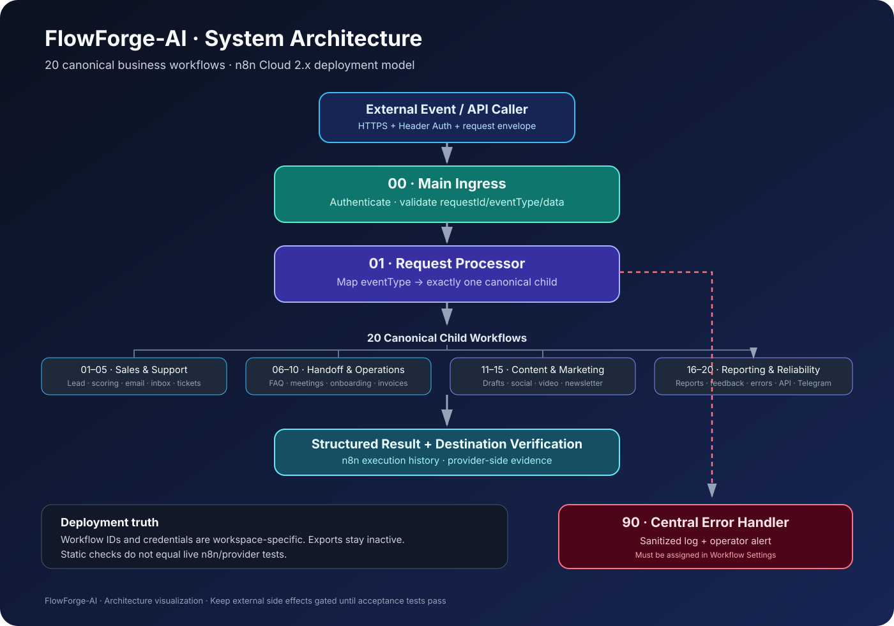

# FlowForge-AI — Visual Workflow Gallery

A visual index of the FlowForge-AI automation system maintained by Muhammad Farhan. Use this page to explore the architecture and jump directly to any of the 20 canonical n8n workflow templates.

> **Status:** This gallery documents repository exports and setup guides. It does not mean workflows have been imported, connected to credentials, or runtime-tested in a live n8n workspace.

## System overview

| Layer | Purpose | Explore |
|---|---|---|
| Main Ingress | Receives and validates the incoming request envelope | [Ingress workflow](../system/00-main-ingress.json) |
| Request Processor | Routes a supported event to the matching child workflow | [Orchestration guide](../system/PARENT-CHILD-ORCHESTRATION.md) |
| Child workflows | Perform one focused business automation task | [Complete catalog](../workflows/README.md) |
| Central Error Handler | Receives workflow errors when assigned in n8n settings | [Error handler export](../system/90-central-error-handler.json) |

## Workflow cards

### Sales and CRM

| Workflow | What it is for | Details |
|---|---|---|
| Lead Capture & CRM | Validate and route new lead records | [Open workflow](../workflows/01-lead-capture-crm/README.md) |
| Lead Scoring & Routing | Score leads and direct them to the right path | [Open workflow](../workflows/02-lead-scoring-routing/README.md) |
| Email Follow-up Sequence | Coordinate follow-up steps | [Open workflow](../workflows/03-email-follow-up-sequence/README.md) |

### Productivity, support and scheduling

| Workflow | What it is for | Details |
|---|---|---|
| Inbox Triage Assistant | Categorize incoming messages | [Open workflow](../workflows/04-inbox-triage-assistant/README.md) |
| Customer Support Desk | Organize support ticket handling | [Open workflow](../workflows/05-customer-support-desk/README.md) |
| FAQ & Human Handoff | Respond to FAQ requests and route complex cases | [Open workflow](../workflows/06-faq-human-handoff/README.md) |
| Meeting Booking System | Process meeting-booking requests | [Open workflow](../workflows/07-meeting-booking-system/README.md) |
| Meeting Reminders | Coordinate reminder events | [Open workflow](../workflows/08-meeting-reminders/README.md) |
| Client Onboarding | Organize onboarding steps | [Open workflow](../workflows/09-client-onboarding/README.md) |

### Finance and content operations

| Workflow | What it is for | Details |
|---|---|---|
| Invoice & Payment Reminders | Prepare payment reminder workflows | [Open workflow](../workflows/10-invoice-payment-reminders/README.md) |
| Content Creation & Approval | Draft content for review | [Open workflow](../workflows/11-content-creation-approval/README.md) |
| Instagram Publishing Pipeline | Coordinate an Instagram publishing process | [Open workflow](../workflows/12-instagram-publishing-pipeline/README.md) |
| YouTube Publishing Assistant | Organize YouTube publishing tasks | [Open workflow](../workflows/13-youtube-publishing-assistant/README.md) |
| Content Repurposing | Adapt content for different formats | [Open workflow](../workflows/14-content-repurposing/README.md) |
| Newsletter Campaign Builder | Prepare newsletter campaigns | [Open workflow](../workflows/15-newsletter-campaign-builder/README.md) |

### Analytics, reliability and messaging

| Workflow | What it is for | Details |
|---|---|---|
| Weekly Business Reporting | Assemble recurring business reports | [Open workflow](../workflows/16-weekly-business-report/README.md) |
| Feedback & Escalation | Route feedback and escalation cases | [Open workflow](../workflows/17-feedback-routing/README.md) |
| Workflow Error Monitor | Process workflow error events | [Open workflow](../workflows/18-workflow-error-monitor/README.md) |
| API Health Monitor | Check API health endpoints | [Open workflow](../workflows/19-api-health-monitor/README.md) |
| Telegram Business Assistant | Route supported Telegram business commands | [Open workflow](../workflows/20-telegram-business-assistant/README.md) |

## Before using a workflow

1. Read the workflow-specific README and the [credentials guide](../workflows/CREDENTIALS-GUIDE.md).
2. Import into a non-production n8n project and keep the workflow inactive.
3. Configure credentials and workspace-specific sub-workflow references inside n8n.
4. Test valid input, invalid input, duplicate/retry behavior, provider failures, and the destination using synthetic data.
5. Verify actual side effects in n8n execution history before enabling real messages, payments, bookings, or publishing.

## Useful links

- [Main README](../README.md)
- [Complete workflow index](../workflows/README.md)
- [Testing and validation](../TESTING-AND-VALIDATION.md)
- [n8n Cloud 2.x deployment guide](../system/N8N-CLOUD-2X-DEPLOYMENT.md)
- [Repository](https://github.com/Farhanillahiclass/FlowForge-AI)
